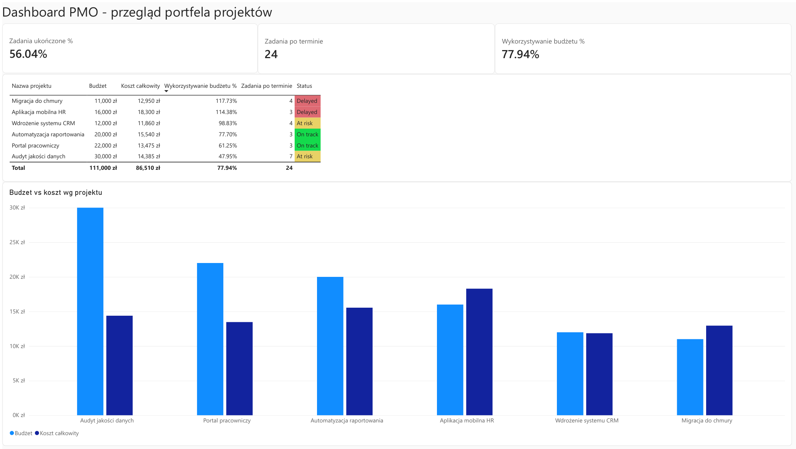
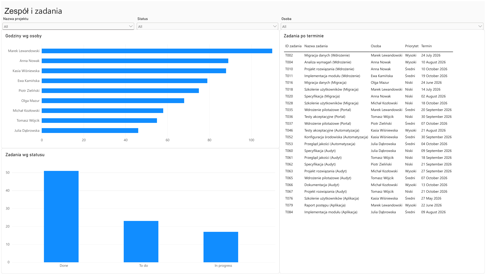

# Dashboard PMO – Power BI

Dwustronicowy raport w Power BI, który pokazuje stan portfela projektów z punktu widzenia biura zarządzania projektami (PMO): budżety, zaległe zadania, obciążenie zespołu i statusy projektów.

Projekt zrobiłam, żeby poćwiczyć pracę z Power BI: import i czyszczenie danych w Power Query, model danych, miary DAX i budowa czytelnego raportu.

> Dane są **wymyślone** (syntetyczne) i służą wyłącznie do celów demonstracyjnych. Stan raportu: **26.10.2026**.

## Podgląd

| Portfel projektów | Zespół i zadania |
|---|---|
|  |  |

## Co pokazuje raport

**Strona 1: Portfel projektów**
- karty z kluczowymi wskaźnikami: ukończone zadania (%), zadania po terminie, wykorzystanie budżetu (%),
- tabela projektów ze statusem (Delayed / At risk / On track) oznaczonym kolorami, posortowana po wykorzystaniu budżetu,
- wykres budżet vs koszt dla każdego projektu.

**Strona 2: Zespół i zadania**
- godziny przepracowane przez każdą osobę,
- liczba zadań wg statusu (Done / In progress / To do),
- lista zadań po terminie,
- fragmentatory: projekt, status, osoba.

## Najważniejsze wnioski

- Dwa projekty przekraczają budżet: **Migracja do chmury (117,7%)** i **Aplikacja mobilna HR (114,4%)**. Oba mają status Delayed.
- Cały portfel wykorzystał **77,9%** budżetu (86 510 zł z 111 000 zł).
- Zaległych jest **24 z 91 zadań**, a najwięcej, **7**, w projekcie **Audyt jakości danych**. Ten projekt ma jednocześnie najniższe wykorzystanie budżetu (48%) i tylko 1 ukończone zadanie na 16, więc jest zagrożony opóźnieniem mimo dużej rezerwy budżetowej.
- Ukończono **56%** zadań (51 z 91).
- Najwięcej godzin przepracował Marek Lewandowski (**110 h**), najmniej Julia Dąbrowska (**46 h**), łącznie 668 h.

## Dane

Plik `PMO_dane.xlsx` zawiera cztery tabele:

| Tabela | Zawartość |
|---|---|
| Projekty | 6 projektów: właściciel, daty, budżet, status |
| Zadania | 91 zadań: projekt, osoba, status, termin, data faktyczna, priorytet |
| Czas pracy | 142 wpisy godzin: osoba, projekt, data, godziny |
| Osoby | 9 osób: rola, stawka godzinowa |

## Model danych

Relacje jeden-do-wielu:
- `Projekty[ID projektu]` → `Zadania[ID projektu]`
- `Projekty[ID projektu]` → `Czas pracy[ID projektu]`
- `Osoby[Osoba]` → `Czas pracy[Osoba]`
- `Osoby[Osoba]` → `Zadania[Osoba]`

## Miary DAX

```dax
Suma godzin = SUM('Czas pracy'[Godziny])

Koszt (kolumna) = 'Czas pracy'[Godziny] * RELATED(Osoby[Stawka godzinowa])

Koszt całkowity = SUM('Czas pracy'[Koszt])

Wykorzystanie budżetu % = DIVIDE([Koszt całkowity], [Budżet])

Liczba zadań = COUNTROWS(Zadania)

Zadania ukończone % =
DIVIDE(
    CALCULATE(COUNTROWS(Zadania), Zadania[Status] = "Done"),
    [Liczba zadań]
)

Zadania po terminie =
CALCULATE(
    COUNTROWS(Zadania),
    Zadania[Status] <> "Done",
    Zadania[Termin] < DATE(2026, 10, 26)
)
```

Stała data w mierze `Zadania po terminie` sprawia, że wyniki nie zmieniają się z dnia na dzień.

## Czego się nauczyłam

- import danych z Excela i czyszczenie w Power Query,
- budowa modelu z relacjami i kolumną obliczeniową z `RELATED`,
- pisanie miar w DAX (`CALCULATE`, `DIVIDE`, `COUNTROWS`),
- warunkowe formatowanie, fragmentatory, filtrowanie wizualizacji miarą,
- projektowanie czytelnego raportu na dwóch stronach.

## Jak otworzyć

Pobierz `Dashboard_PMO.pbix` i otwórz w Power BI Desktop (Windows, darmowy).

## Możliwe dalsze kroki

- dodanie osi czasu (postęp projektów w czasie),
- prognoza kosztu na koniec projektu,
- wskaźnik obciążenia osób względem dostępności.
